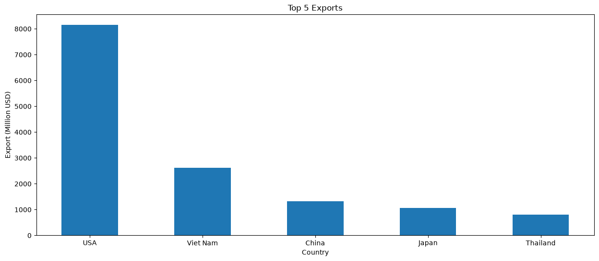
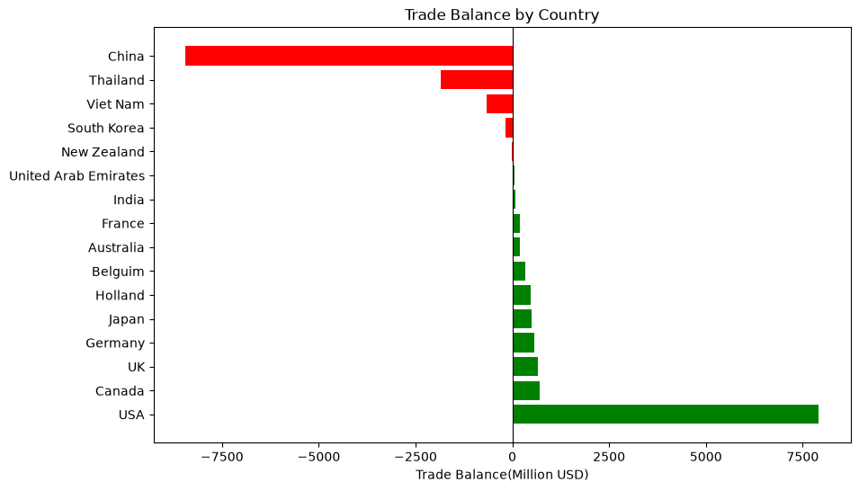

# Cambodia Global Trade Analysis (Jan-Nov 2023)

## 📌 Project Overview
This project analyzes Cambodia's international trade data from January to November 2023 to identify the country's top trading partners, assess market share, and evaluate trade surpluses and deficits. The goal of this analysis is to determine the concentration of Cambodia's global trade and visualize key economic dependencies.

## 🧰 Tools & Technologies Used
* **Python 3** (Data cleaning, manipulation, and analysis)
* **Pandas** (Dataframe filtering, aggregation, and feature engineering)
* **Matplotlib** (Data visualization: Vertical and horizontal diverging bar charts)
* **Jupyter Notebook** (Development environment)

## 📂 Dataset
The dataset (`TradewithKeysPartnersCountriesfromJan-Nov2023.csv`) contains 21 rows of aggregate and country-specific trade data. 
Source: [Trade with Keys Partners Countries from Jan-Nov 2023](https://data.mef.gov.kh/datasets/pd_675fb32b255e6c0001248206?page=1)
* **Key Features:** `export_destination`, `export_million_usd`, `import_million_usd`, `trade_amount_million_usd`

*Note: The dataset was pre-processed to separate regional aggregates (e.g., "World", "ASEAN", "European Union") from individual country data to prevent double-counting and skewed visualizations.*

## 📊 Key Findings & Insights
From January to November 2023, Cambodia's global trade heavily relied on three primary partner nations, which collectively accounted for over 58% of the country's total international trade volume:

1. **China (25.46% Market Share):** The largest overall trading partner, driven predominantly by high import volumes resulting in a trade deficit of -$8,448 million.
2. **United States (19.23% Market Share):** The primary engine for export earnings, single-handedly generating a robust trade surplus of +$7,921 million.
3. **Vietnam (13.51% Market Share):** A balanced, high-volume regional partner with a moderate deficit of -$655 million.

## 📈 Visualizations

### Top 5 Export Partners

*Highlights the extreme market dominance of the USA in purchasing Cambodian exports.*

### Global Trade Balance Breakdown

*A diverging bar chart showcasing trade surpluses (Green) vs. trade deficits (Red).*

## ⚙️ How to Run This Project
1. Clone this repository to your local machine.
2. Ensure you have Python installed, along with the `pandas` and `matplotlib` libraries.
3. Open the Jupyter Notebook (`[Insert_Notebook_Name].ipynb`) to view the code, data cleaning steps, and visualization logic.
